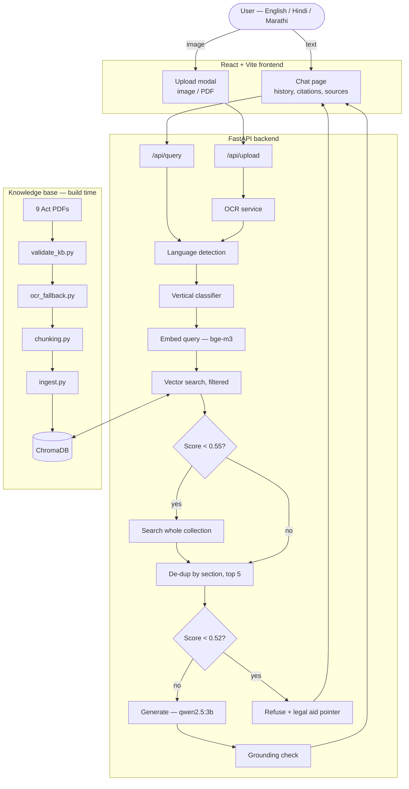

# NyayAI — Architecture and Workflow

## 1. What the system is

NyayAI is a retrieval-augmented generation (RAG) application that answers
questions about Indian law for people who cannot afford a lawyer. Every
answer is generated **only** from a fixed knowledge base of official Acts,
and every answer carries the sections it was built from, so a user can
check it against the statute.

It is a RAG system in the strict sense the capstone brief asks for: the
language model never answers from its own training knowledge. If retrieval
returns nothing relevant, the system refuses rather than generating.

## 2. Diagram

The source is [`architecture.mmd`](architecture.mmd) (Mermaid). GitHub
renders the block below directly.



## 3. Request walkthrough

A question travels through seven stages. Each is a separate module, so each
can be tested and replaced on its own.

| # | Stage | Module | What happens |
| --- | --- | --- | --- |
| 1 | Language detection | `services/language.py` | `langdetect` picks en / hi / mr; anything else falls back to English. Decides the language the answer is written in. |
| 2 | Domain routing | `services/classifier.py` | Keyword match first (instant, free); if nothing matches, one LLM call returns a single category word. Output is one of rti / tenancy / consumer / family / criminal / general. |
| 3 | Query embedding | `services/embeddings.py` | The question is embedded with `BAAI/bge-m3`, the same model used at index time. The model is multilingual, so a Hindi question and English statutory text land in the same vector space. |
| 4 | Vector search | `services/vectorstore.py` | Chroma returns the 15 nearest chunks by cosine similarity, filtered to the classified domain. |
| 5 | Retrieval strategy | `services/retrieval.py` | If the filtered search is weak (top score < 0.55) the search is repeated across the whole collection and the better result wins. Hits are then capped at two per (file, section) and cut to the top 5. |
| 6 | Abstention gate | `services/retrieval.py` | If the best remaining similarity is below 0.52, the pipeline stops. No LLM call is made and the user is told the knowledge base does not cover the question. |
| 7 | Generation + check | `services/rag.py` | The 5 chunks are formatted as numbered, citation-labelled passages. `qwen2.5:3b` answers under a prompt that forbids outside knowledge. The answer is then re-read and any section number absent from the context is flagged. |

The response returned to the UI contains the answer, the five source chunks
with their Act, section, page and similarity score, the grounding result,
and a diagnostics block describing exactly what retrieval did.

## 4. Why these components

| Decision | Choice | Reason |
| --- | --- | --- |
| Embedding model | `BAAI/bge-m3` | Multilingual and trained for retrieval. It lets a Hindi or Marathi question retrieve English statutory text directly, which removes the need for a translation stage. 8192-token input, so no chunk is ever truncated. |
| Vector store | ChromaDB (persistent, local) | Runs in-process with no server to operate, supports metadata filtering (needed for the per-domain filter), and persists to a directory that can be shipped with the project. |
| LLM | `qwen2.5:3b` via Ollama | Fits in 8 GB RAM alongside the embedding model, runs locally so no user's legal question leaves the machine, and is multilingual enough to answer in Hindi and Marathi. |
| Vision model | `qwen3-vl:2b-instruct` | Replaced moondream, which is English-only and returned near-empty text for Devanagari documents. |
| Chunk size | 900 chars, 180 overlap | Measured against these Acts: large enough to hold a provision with its governing sentence, small enough that a top-5 retrieval stays on one topic. |
| Relational DB | SQLite | One file, no server; stores the query log only. |

## 5. Knowledge base build

`ingestion/` is a three-step pipeline, run in this order:

1. **`validate_kb.py`** — checks every PDF for a real PDF header, a readable
   page tree, an extractable text layer, and (for files named `_hi`/`_mr`)
   actual Devanagari content. It writes `kb_validation.json`.
2. **`ocr_fallback.py`** — for the files validation rejects, rasterises each
   page with `pdftoppm` and reads it with EasyOCR, caching one `.txt` per
   page so the work is never repeated.
3. **`ingest.py`** — cleans and chunks every document, attaches citation
   metadata from `ACT_REGISTRY`, embeds in batches and writes to Chroma. It
   drops and rebuilds the collection each run, so re-running cannot create
   duplicates. Writes `ingestion_stats.json`.

Each chunk is stored with: `vertical`, `source`, `act`, `year`,
`jurisdiction`, `doc_language`, `section`, `section_title`, `chapter`,
`page_start`, `page_end`, `text_source` (`pdf_text_layer` or `ocr`) and
`chars`.

## 6. Repository layout

```
backend/
  app/
    api/        routes_health.py  routes_query.py  routes_retrieval.py  routes_upload.py
    core/       config.py              settings, path resolution
    db/         database.py models.py  SQLite query log
    models/     schemas.py             Pydantic request/response contracts
    services/   language.py classifier.py embeddings.py vectorstore.py
                retrieval.py rag.py llm.py ocr.py
  tests/        test_api.py            35 tests, no server required
ingestion/
  validate_kb.py  ocr_fallback.py  chunking.py  ingest.py
  chroma_store/   built vector store
  ocr_cache/      cached OCR text
evaluation/
  test_queries.json  33 labelled cases
  run_eval.py  calibrate.py  validate_expectations.py
  results/     eval_report.md, eval_results.json, threshold_calibration.json
nyayai-frontend/  React + Vite + Tailwind
data/legal_docs/  9 Act PDFs, by domain
docs/             this file, architecture diagram
```

## 7. API surface

| Method | Path | Purpose |
| --- | --- | --- |
| GET | `/api/health` | Index size, chunks per domain, Acts indexed, whether Ollama is reachable. |
| POST | `/api/query` | Question in, grounded answer + sources + diagnostics out. |
| POST | `/api/retrieve` | Retrieval only, no generation. Shows exactly which chunks a question pulls. |
| POST | `/api/upload` | Image/PDF in, OCR text + answer out. |
| GET | `/docs` | Interactive Swagger UI. |

## 8. Known limitations

- The knowledge base is nine Acts. Tax, immigration, labour, property-title
  and corporate law are not covered; questions about them are refused.
- `qwen2.5:3b` is a small model. It is accurate when the retrieved context
  is right, but it summarises loosely and occasionally omits a qualifying
  clause. The cited sections are the authoritative part of any answer.
- Two source documents (the Maharashtra Rent Control Act scan and the Hindi
  RTI gazette) are OCR'd, so their text carries OCR noise.
- The vertical classifier is keyword-first; an unusually phrased question
  falls through to an LLM call, which adds latency.
- Login is a local mock. There is no real authentication, and no user data
  is stored server-side beyond the query log.
